<h1 align="center">🎺 Better Rust Trumpet</h1>

<p align="center">
  <a href="https://github.com/tokenbroker/BetterRustTrumpet/releases">
    
  </a>
  <a href="https://github.com/tokenbroker/BetterRustTrumpet/actions/workflows/ci.yml">
    
  </a>
  <a href="LICENSE">
    
  </a>
</p>

<p align="center">
  <i>Per-app volume control for Windows, from the notification area.</i><br/>
  <i>A Rust rewrite of BetterTrumpet: the same features and settings in a small native app.</i>
</p>

<p align="center">
  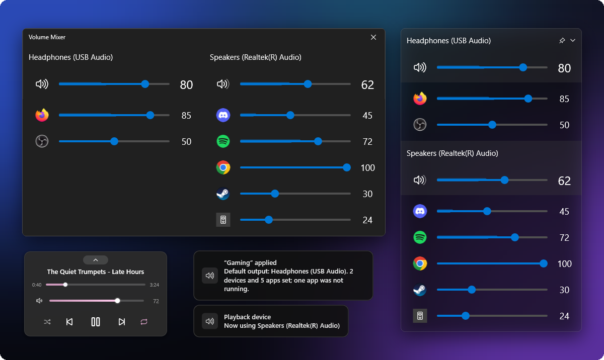
</p>

<p align="center">
  <a href="#trying-it">Install</a> ·
  <a href="#features">Features</a> ·
  <a href="#command-line">CLI</a> ·
  <a href="#reporting-a-problem">Report a problem</a> ·
  <a href="#building">Build</a> ·
  <a href="#credits-and-licence">Credits</a>
</p>

---

A rewrite of [BetterTrumpet](https://github.com/xammen/BetterTrumpet) (itself
built on [EarTrumpet](https://github.com/File-New-Project/EarTrumpet)) in Rust.

- **Small and native.** Win32 windows drawn with Direct2D: no web view, no
  .NET runtime. One process, about 5 MB of memory and no CPU while idle.
- **Your settings come along.** It reads your existing EarTrumpet/BetterTrumpet
  settings but never changes them. Its own settings live in
  `%LOCALAPPDATA%\BetterTrumpet-Rust`.
- **No telemetry.** The only network requests are an opt-in update check
  (every 6 hours it asks this repository's GitHub releases for a newer
  version) and, when you choose **Update now**, the download of that update.
  Updates are signed: the app installs one only if its signed manifest
  verifies against the key built into it, and it never installs an older
  version.

**Status: alpha.** Most features are in but much of it has not been tested on
other machines yet. Bug reports are very welcome (see
[Reporting a problem](#reporting-a-problem)).

## Trying it

1. Download `BetterRustTrumpet-<version>-setup.exe` from the
   [releases](../../releases) and run it. It installs for your account only
   (no admin prompt) into `%LOCALAPPDATA%\Programs\BetterRustTrumpet`, adds a
   Start menu entry and an uninstaller (Settings > Apps), and offers a
   desktop icon, starting with Windows and `bt` on PATH. Or download
   `BetterRustTrumpet-<version>.zip`, unzip it anywhere and run
   `BetterTrumpet.exe`.
2. Windows SmartScreen may warn because the files are not code-signed:
   choose **More info**, then **Run anyway**.
3. Quit the C# BetterTrumpet or EarTrumpet first if it is running; both would
   add a tray icon and claim the same shortcuts. The two can be installed
   side by side.
4. Later versions install from inside the app: **Update now** in the flyout,
   the tray menu or Settings > Updates.

Requires Windows 10 or 11, x64.

To uninstall: quit it from the tray menu, turn off "Run at Windows startup"
first if you turned it on, then delete the folder and
`%LOCALAPPDATA%\BetterTrumpet-Rust`.

## Features

### Per-app volume

<p align="center">
  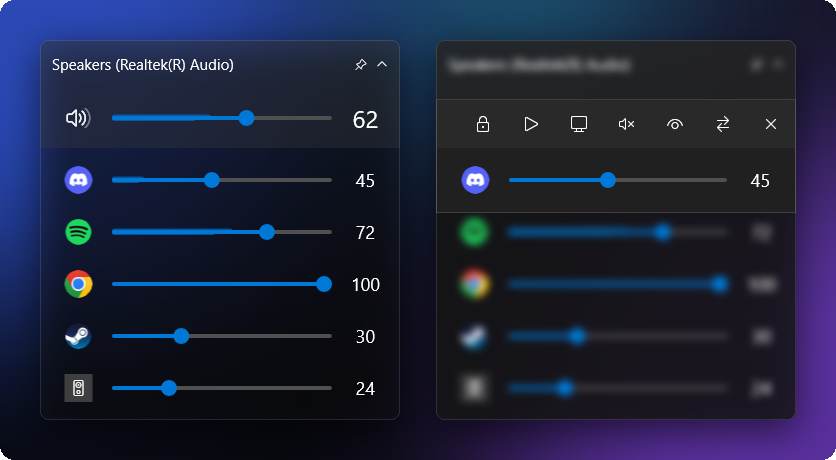
</p>

- Click the tray icon: every playing app has its own slider, mute and peak
  meter, grouped by output device.
- Send an app to another output (game on the headset, music on the speakers).
- Hide the apps and devices you never touch.
- `Ctrl+click` an app to solo it, `Ctrl+Z` / `Ctrl+Y` to undo and redo volume
  changes, `Ctrl+P` to pin the flyout open.
- Scroll over the tray icon to change the volume; middle-click it to mute.
- Global shortcuts for the flyout, the mixer, volume up/down and switching
  devices, plus one shortcut per device.

### App rules

Right-click an app in the flyout, or open Settings > App rules. Rules follow
the app across restarts:

- **Lock:** the volume stays put, whatever the app tries.
- **Launch volume:** the app always starts at the volume you chose.
- **Keep muted:** muted every time it makes a sound.
- **Folder defaults:** a starting volume for everything installed in a folder
  (handy for game libraries).
- **Focus lost:** quietly lower apps when you switch away from them, with a
  fade.

### QuickTrumpet presets

Save the current setup and bring it back in one click, from a shortcut or from
the command line. A preset can switch your default output and microphone, set
device volumes and set app volumes, in any combination.

<details>
<summary>Screenshot: saving a preset</summary>
<br/>
<p align="center">
  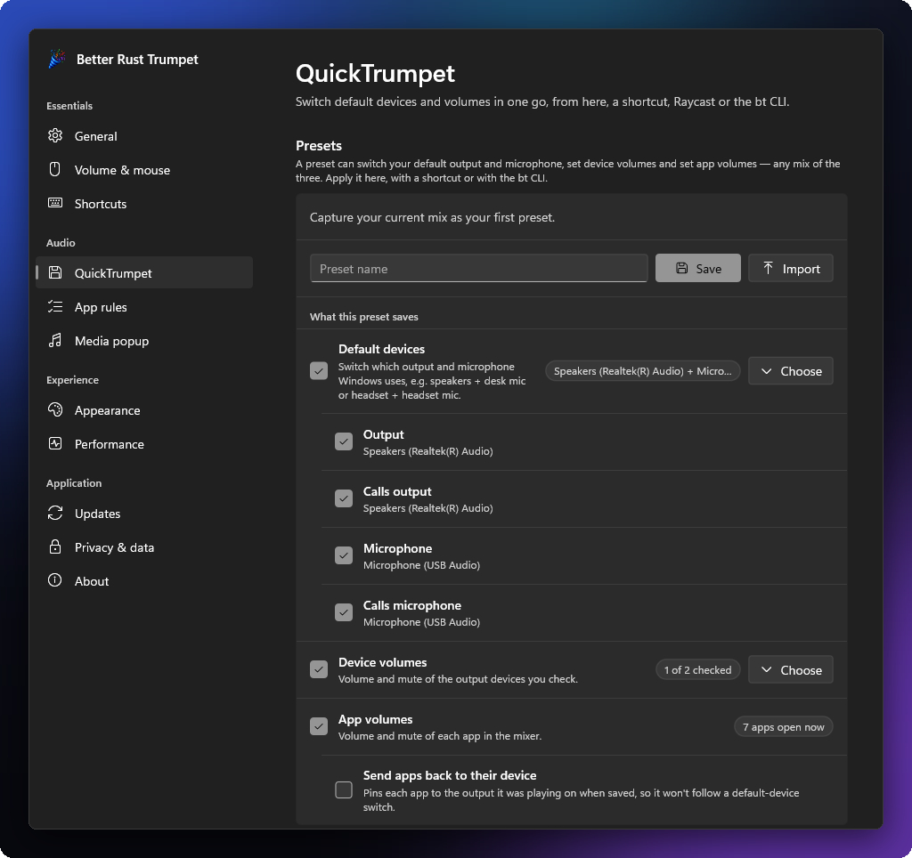
</p>
</details>

### Media popup

<p align="center">
  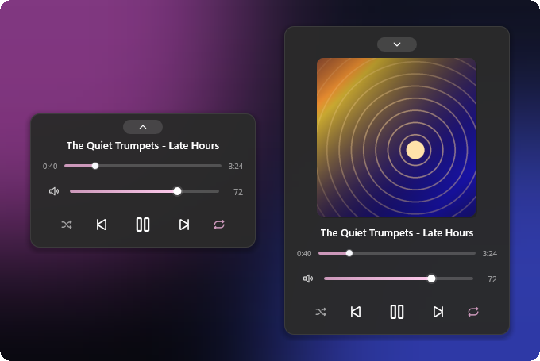
</p>

Hover the tray icon to see what's playing: play/pause, skip, seek, shuffle,
repeat and the app's own volume. Expand it to show the cover art.

### Make it yours

<div align="center">
  <table>
    <tr>
      <td align="center">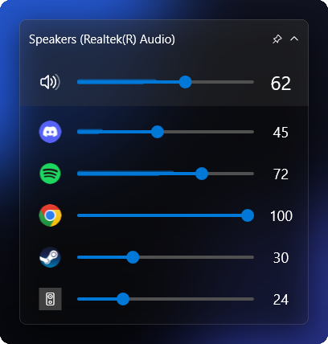<br/><sub>Default</sub></td>
      <td align="center">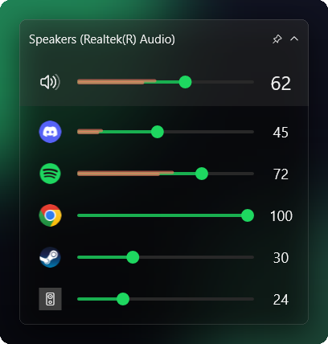<br/><sub>Spotify</sub></td>
      <td align="center">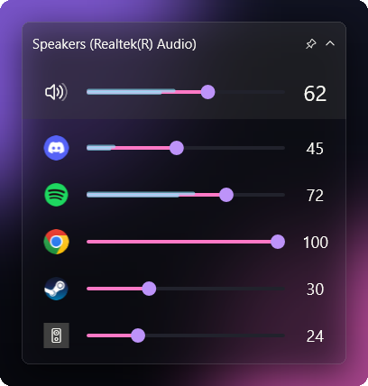<br/><sub>Dracula</sub></td>
    </tr>
    <tr>
      <td align="center">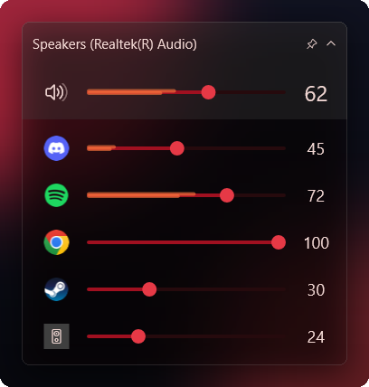<br/><sub>Blood Moon</sub></td>
      <td align="center">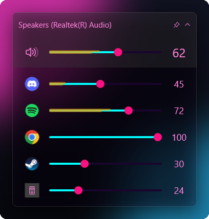<br/><sub>Synthwave</sub></td>
      <td align="center">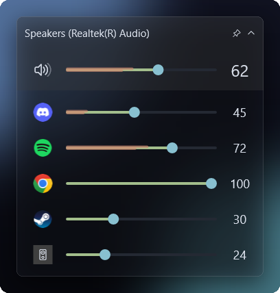<br/><sub>Nord</sub></td>
    </tr>
  </table>
</div>

- 14 built-in themes, or pick your own seven colours and save them.
- Window opacity, five peak meter styles, and an album-art mode that takes its
  colours from the cover of what's playing.
- An Eco Mode that lowers refresh rates and stops the tray animation, always
  or only on battery.
- Follows the Windows light/dark setting and high contrast, with the
  original's translations.

<p align="center">
  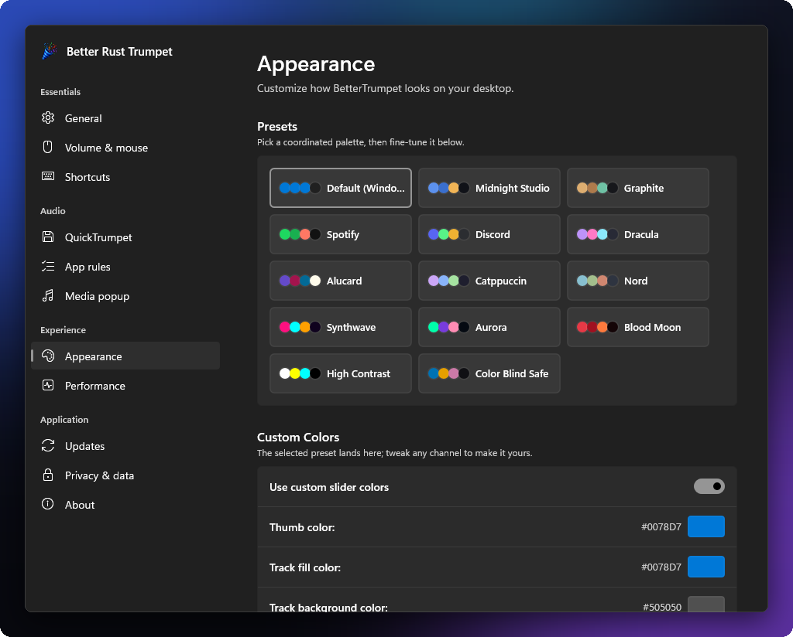
</p>

### A tray icon that tells you where the sound goes

<p align="center">
  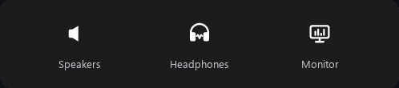
</p>

The tray icon follows the volume, can show the kind of output you're on
(speakers, headphones or a monitor) and moves while something plays. The
device type and the animation each have a switch in Settings.

### Mixer window and command palette

<p align="center">
  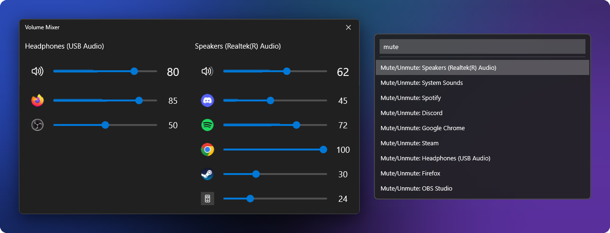
</p>

The mixer window shows every output side by side. `Ctrl+Shift+P` opens a
command palette: type a few letters to mute an app or a device, switch the
default output, or open the mixer and settings.

## Command line

`bt.exe` is an optional command-line tool that talks to the running app and
answers in JSON, so it's easy to script. The installer can add it to PATH.

```powershell
bt --help                        # everything it can do
bt --list-devices                # devices and their apps
bt volume discord 40             # set an app's volume
bt toggle-mute spotify
bt --set-default "Headphones"    # switch the default output
bt save gaming                   # save the current setup as a preset
bt gaming                        # ...and apply it later
bt preset next                   # cycle through presets
bt doctor                        # quick health check
```

## Reporting a problem

Open an [issue](../../issues/new/choose) with what you did, what happened and
your Windows version. Please attach the newest log from
`%LOCALAPPDATA%\BetterTrumpet-Rust\logs`, or a diagnostic report from
Settings > About > Export diagnostic report (which replaces user names in
paths). Logs and reports stay on your PC unless you attach them; they can
contain device and app names, so have a look first.

[docs/MANUAL_TESTS.md](docs/MANUAL_TESTS.md) lists things worth trying.

## Building

Requires Windows 10 or 11 and [Rust](https://rustup.rs) 1.88 or newer (the
MSVC toolchain, with the Visual Studio C++ build tools).

```powershell
cargo build --release
cargo test --workspace
```

The app is `target\release\BetterTrumpet.exe` and the CLI
`target\release\bt.exe`. The C runtime is linked statically
(`.cargo/config.toml`), so the exe runs without the Visual C++
redistributable.

Releases are built by GitHub Actions (`.github/workflows/release.yml`) when a
`v*` tag is pushed, so the published exes never contain a local machine's
paths. Every push and pull request runs format, clippy and tests
(`.github/workflows/ci.yml`).

`cargo run -p bt-app --release -- --render <folder>` draws every window to
PNG files without opening anything, which is handy for checking UI changes.
The screenshots above were drawn that way, with stand-in device names, apps
and track.

| Crate | What it holds |
| --- | --- |
| `bt-core` | Settings, rules, presets, CLI and compatibility logic; portable and tested against behaviour captured from the original (`tests/fixtures`) |
| `bt-storage` | Reading the original's settings and the app's own file |
| `bt-audio` | Windows Core Audio (devices, app sessions, volume, peaks) |
| `bt-media` | The Windows media session (now playing, controls, art) |
| `bt-app` | The tray app; all Win32 code is in `src/win32` |
| `bt-cli` | The `bt` command-line client |

Design decisions are recorded in [docs/DECISIONS.md](docs/DECISIONS.md) (the
`Dnn` and `Qnn` references in the code), feature parity in
[docs/PARITY.md](docs/PARITY.md).

## Credits and licence

Better Rust Trumpet ports the behaviour, translations, sounds and artwork of:

- **EarTrumpet** by David Golden, Rafael Rivera and Dave Amenta, with
  translations by the EarTrumpet community.
- **BetterTrumpet** by xammen.

Code adapted from the .NET runtime, WPF and Newtonsoft.Json is listed in
[THIRD_PARTY_NOTICES.md](THIRD_PARTY_NOTICES.md); the translation files are
described in [crates/bt-app/locales/NOTICE.md](crates/bt-app/locales/NOTICE.md).

Released under the [MIT licence](LICENSE), including the upstream preamble
that excludes certain entities. Keep the whole `LICENSE` file, preamble
included, in copies and distributions.
